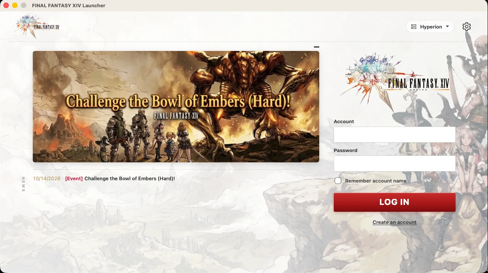

# XIV 1.0 Launcher



A launcher for FINAL FANTASY XIV 1.23b private servers, for Windows and macOS.

It does three things:

- **Sign in.** You log in to a private server, or create an account there.
- **Update.** It downloads the retail patches your install is missing and applies them.
- **Play.** It starts the game and connects it to the server. On Windows that is `ffxivgame.exe`.
  On macOS it is the native recompiled client.

## Building

Built with [Tauri 2](https://tauri.app) (Rust).

```sh
cd src-tauri
cargo tauri dev     # run it
cargo tauri build   # make an installer / .app
```

